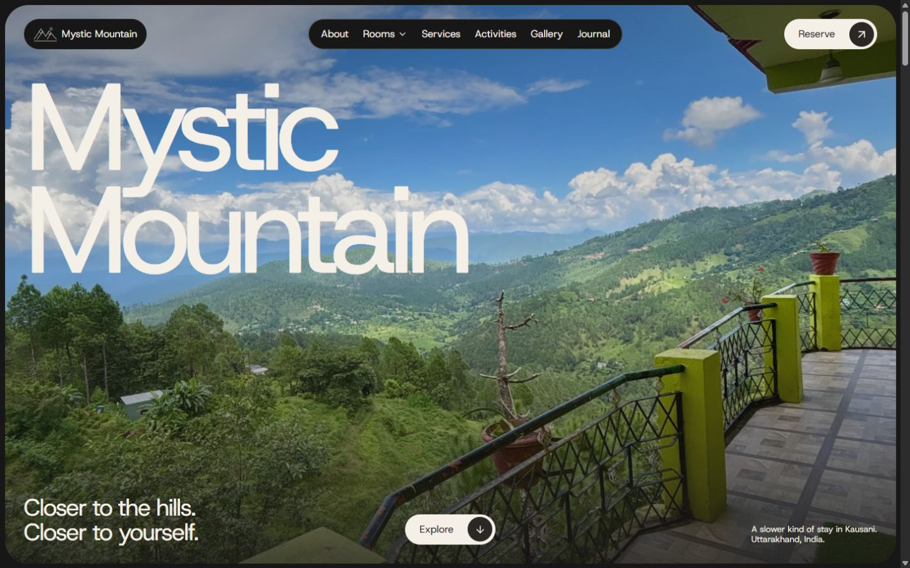
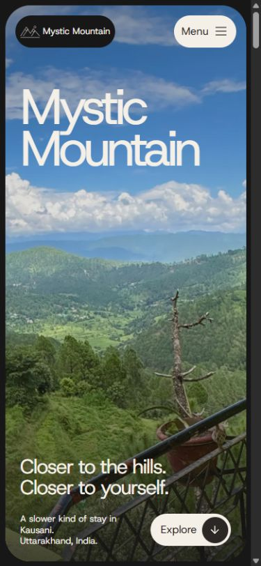

# Capsules delivery — Hotel Mystic Mountain Kausani

Completed 11 November 2026 in the existing local React/Vite project.

## Design authority and implementation

The user-supplied `DESIGN.md` is saved at the project root, including its YAML tokens and complete prose. `AGENTS.md` explicitly makes it the authority for future screens. The previous Tidescape composition is retained in `docs/archive/tidescape-source/`.

The active site uses only locally hosted Host Grotesk 400 and 600. Its page/surface color is #181717, main text and primary fill #F4EFE7, secondary text #B1A696, and primary control text #2A2725. Body text is 13.5px/1.5, primary control labels 16px/1.5, and small labels 13.5px/600. Large headings scale with the viewport. The content cap is 1440px, sections use 52.5px vertical padding, major photo surfaces have 37.5px corners, and controls are pills. Separation uses neutral hairlines and inset rings; no cast shadows or saturated UI accents were added. Natural hotel-photo colors are retained.

A rounded photographic hero replaces the preceding collage. Responsive room cards replace long pinned room sequences, and the other sections follow the same flat dark system. Every secondary route, the missing-page fallback, the menu, lightbox, inquiry form and review dialog use that system.

CSS transitions and Motion entrances/image changes run for at most 150ms using cubic-bezier(.4,0,.2,1). The JavaScript easing/timing constants live in `src/design.ts`; Lenis uses the same easing and 150ms duration. Embla duration is a spring parameter rather than milliseconds, so navigation snaps immediately to avoid a long settling tail. Pointer dragging remains continuous, while selected-photo emphasis changes over 150ms. Manual and system reduced-motion preferences disable movement and Lenis.

## Verified story

A guest can explore real room photographs, navigate to a room detail, carry a room preference into the contact form, select dates and guests, review an inquiry, and copy the correctly formatted details or open the prepared email link. The site retains the verified existing booking portal and contact details.

| Boundary | Evidence |
|---|---|
| All routes render | Fourteen routes checked at 1440×900 and 390×844. All used Host Grotesk and the charcoal background, with zero measured document overflow and no failed loaded images. |
| Responsive controls | Additional home/contact checks at 320×780, 768×1024 and 1024×900. Navigation controls remained separate; visible primary controls measured 48px high. Narrow-phone date and guest fields stack. |
| Menu → room → inquiry | Phone menu opened and locked the page; selecting Rooms closed it. The room detail linked to `/contact?room=timber#plan`, where the form selected “A timber room.” |
| Form → review | At 320px, dates 2026-12-12 to 2026-12-15 and the room preference appeared correctly in the review dialog and encoded mailto link. |
| Review → copy | A desktop sample inquiry showed “Copied” after Copy details. No email was sent. |
| Dialog → page | Escape closed the inquiry dialog and restored focus to Review inquiry; lightbox Escape restored focus to its originating photograph. |
| Carousel → lightbox | Next advanced 01→02, ArrowRight advanced 02→03, and the third photograph opened correctly. A further lightbox arrow advanced its caption and image. Pointer dragging advanced the carousel. |
| Smooth anchors | The Explore link reached the introductory section with its top at 22px, without a native/Lenis jump conflict. |
| Reduced motion | Toggle removed the Lenis class and set computed transitions to 0s; the preference survived reload. Toggling back restored normal motion. |
| Missing page | Fallback rendered 404 with Host Grotesk and #181717. |
| Runtime | Browser warning/error log was empty at the end of verification. |

The DOM measurements are stored in `docs/capsules-redesign/route-audit.json`. Representative screenshots are in the same directory: home desktop/phone, introduction, gallery, contact and inquiry review.

## Project checks

- `npm run build`: passed TypeScript and Vite production build.
- `npm test`: all 8 date/guest/inquiry tests passed.
- `npm audit --omit=dev`: 0 vulnerabilities.
- SHA-256 verification: all 53 originals match the recorded inventory; 0 changed. See `docs/capsules-originals-verification.json`.
- React review: shared semantic controls, effect cleanup, native dialog focus management, reduced motion, local font loading, lazy images with reserved dimensions, and no new animation engine. Prior unused design source is preserved and not imported by the active entry point.

Production output: approximately 453.30kB JavaScript / 148.53kB gzip and 31.22kB CSS / 6.52kB gzip. Modern browsers load two local WOFF2 font files of approximately 13.68kB and 13.73kB. One local warm-cache home check reported 152ms LCP, 0 CLS and 16ms maximum captured interaction; this is a development observation, not a public field-performance result.

## Preserved data and scope

The genuine photos, verified phone/email/address, external booking link, three descriptive room stories and honest inquiry flow remain. No guest quotes, rates, availability or booking confirmations were invented. The California location and capsule-house claims in the reference were not used as hotel content.

Existing Blender assets and earlier source remain available. They are not loaded by this version, which prioritizes the supplied photographic design. No additional generated media, paid service, hosting change or DNS change was used for this revision.

This is a local static-site deliverable. The email app and hotel inbox complete the inquiry outside the website; external reservation availability and receipt were not tested. Before public hosting, configure SPA route fallback and the final canonical/OG/sitemap origin. Keep `hotel.booking` pointing to the actual booking engine if replacing the old domain.

## Visual evidence

