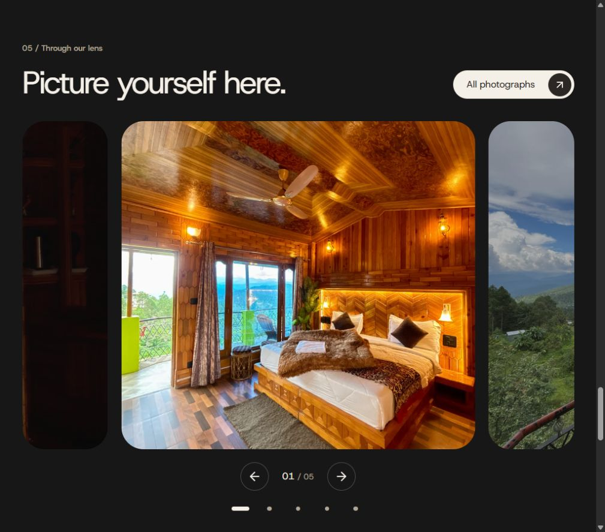

# Reactive components and motion update

Completed 11 November 2026. The root `DESIGN.md` remains unchanged and continues to govern every screen.

## Changes

- Shared buttons, navigation, contact links, image actions, form controls and gallery selectors respond to hover, focus and press. Active routes are marked with `aria-current` and a neutral visual indicator; the Rooms control also reflects room-detail routes.
- Linked and expandable photos respond to mouse position with a bounded 7.5px pan and 4% zoom. Geometry is cached on pointer entry; movement writes CSS variables rather than React state. Focus and touch press feedback remain available without hover. Native image dragging is disabled.
- The hero, landscape chapter, closing photo and secondary-page hero photographs follow scroll progress with a small vertical displacement. No autoplay loop or continuous React state updates are used.
- The introductory photograph now opens the native photo lightbox with an explicit expand control.
- Section entrances and route changes use short displacement and opacity transitions. Photo-story copy responds when its thumbnail is selected.
- The gallery has five labelled 45px selection controls, animated selected markers and a directional 150ms fade/zoom response. Counter, keyboard navigation, drag gestures and the lightbox remain coordinated. Embla retains immediate track snaps to respect the timing limit; the selected image supplies the timed visual transition.
- FAQ disclosures keep native details/summary semantics and keyboard activation. Measured height animation opens and closes over 150ms, supports a second click during motion, and cancels cleanly on route changes or preference changes.
- Form fields highlight focus within the neutral palette; validation and copy feedback animate briefly. Narrow-phone menu contact sizing was corrected, and menu navigation now leaves focus on the destination heading.

All timed effects use the supplied 150ms maximum and cubic-bezier(.4,0,.2,1). Scroll-linked movement follows scroll directly. System/manual reduced motion removes the new image displacement and parallax, disables timed transitions, and keeps disclosures immediate.

## Verification

- TypeScript/Vite production build passed. Output: 466.16kB JS / 153.28kB gzip and 38.25kB CSS / 7.58kB gzip.
- All eight existing inquiry/date/guest tests passed. The booking logic and property data were retained.
- All fourteen routes audited at 390px and 1440px: no horizontal document overflow, Host Grotesk throughout, and no computed CSS transition exceeding 0.15 seconds. Raw measurements: `capsules-redesign/interaction-audit.json`.
- Additional 320px gallery check: five 45px targets, zero horizontal overflow, selection and counter synchronized at 05/05, lightbox opened and Escape restored focus to the originating photo.
- Additional 1024px gallery check: direct selection synchronized at 03/05 and zero horizontal overflow.
- Pointer test confirmed actual image displacement (-4.5px, +4.41px) and scale 1.04 on the expandable introduction photo; clicking opened its three-photo lightbox.
- FAQ keyboard and repeated-toggle tests settled at the correct native open/closed state, with no leftover inline height or overflow.
- Active About navigation exposed `aria-current="page"`. Mobile Gallery navigation closed the menu, released the scroll lock and focused its H1.
- Reduced-motion test removed Lenis, returned all three large home photo transforms to `none`, set CSS transitions to 0s and made FAQ collapse immediate.
- Browser warning/error log was empty after the checks. Phone menu email now computes at 13.5px within a single 45px row at 320px.

No new library or service was installed. Existing Motion, Lenis and Embla are reused, together with native browser animation for disclosure height. Existing React Bits decisions were updated in `react-bits-component-map.md`. Native touch hardware was not exercised; pointer dragging, keyboard behavior and phone target/layout dimensions were checked in the Chromium preview.

